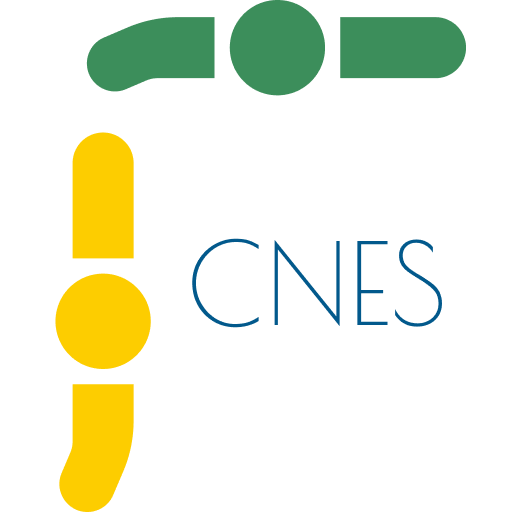

# FlexCNES — Assistente de preenchimento de fichas e planilha CNES

Aplicativo desktop (Python + CustomTkinter + SQLite), com tema Sistema/Claro/Escuro que coleta os dados e preenche:
- **Ficha 20** (Cadastro de Profissional) e **Ficha 21** (Continuação, até 3 vínculos por página; várias páginas se preciso) — em PDF, sobre os modelos originais. Pode-se gerar só a 20, só a 21 ou as duas.
- **Planilha "ALTERAÇÕES CNES"** — acrescenta/atualiza a aba do mês (inclusão, exclusão, outras alterações).

## Executar
    pip install -r requirements.txt
    python main.py
(Tkinter vem com o Python do Windows/macOS; no Linux: `sudo apt install python3-tk`.)

## Como funciona?
1. **Primeiro acesso**: cria usuário administrador. Ele que cadastra, edita e desativa outros usuários.
2. **Usuários gerais**: no primeiro acesso, define uma senha definitiva. Somente usuário logado preenche documentos. Cada usuário pode resetar sua própria senha.
3. **Base CNES (opcional, mas recomendado)**: menu para importar o ZIP do DATASUS; com ela, basta digitar o CNES para preencher o estabelecimento e a busca por municípios e CBOs é ativada.
4. **O estabelecimento**: cadastrado uma vez (CNES, nome fantasia, município, regional de saúde...), reutilizado em cada geração e ainda é editável.
5. **Fichas e Planilha**: Fichas podem ser geradas logo após o preenchimento, mas há histórico dos registros, edição e regeração. A planilha é gerada depois e sai em .xlsx (se o **LibreOffice** estiver instalado, também é convertida para .xls).

Dados ficam em SQLite, por padrão `%APPDATA%\FlexCNES_Preenchimento`, mas um diretório customizado pode ser especificado pelo administrador. Cada computador guarda essa escolha no seu próprio `config.json`.

> [!NOTE]
> O SQLite em pasta de rede é possível, mas funciona para poucos usuários simultâneos. Evite sincronizadores (OneDrive/Dropbox) na pasta do banco e faça cópias de segurança da pasta com frequência.
> A base CNES importada continua local.

## Testes
    python tests/test_core.py
    python tests/smoke_gui.py    # usa um Tkinter simulado; não substitui um teste visual no Windows

## Gerar EXE (no Windows)
    pip install -r requirements.txt pyinstaller
    pyinstaller --onefile --windowed --name FlexCNES --icon assets/icon.ico --collect-all customtkinter --add-data "assets;assets" main.py
Resultado: `dist/FlexCNES.exe`. O tema escolhido fica em `config.json` na pasta de dados.
